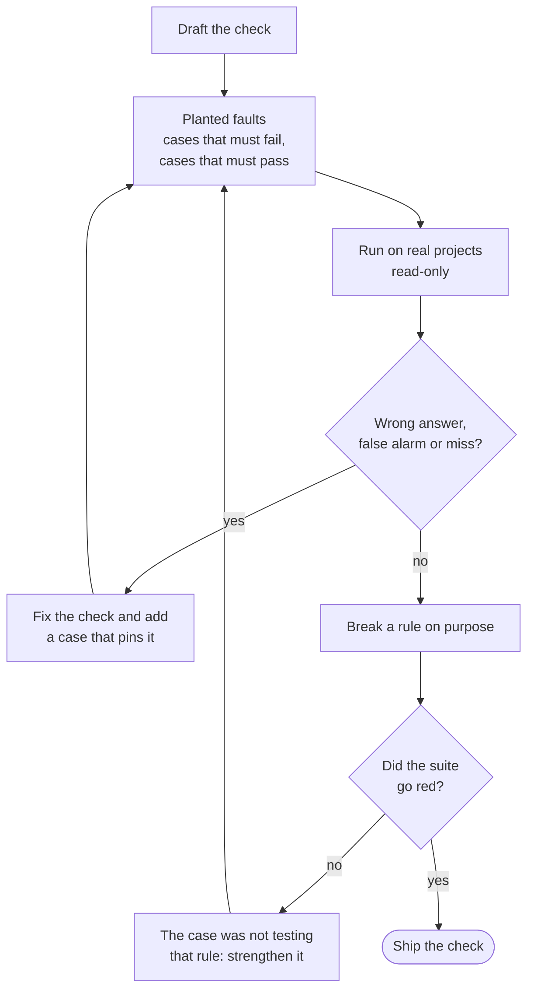

<!-- SPDX-FileCopyrightText: 2026 Georges Martin <jrjsmrtn@gmail.com> -->
<!-- SPDX-License-Identifier: MIT -->

# How a check is built and proved

[Why the skills ship checks, not just instructions](why-checks-fail-instead-of-instruct.md)
ends on a problem: a check can pass without having checked anything. This page explains what the
plugin does about that, and why a script is not treated as trustworthy just because it exists.

It is background on how the checks are made. It does not tell you how to run one.

## Who checks the checker?

A script that has only ever reported success tells you very little. It might be correct. It might
also be testing the wrong thing, reading its input wrongly, or skipping the cases that matter.
From the outside the two look the same, which is the same trap as an instruction nobody can see
being followed.

So before a check ships, it has to be shown capable of failing, and capable of failing for the
right reason. The plugin uses four kinds of evidence, each covering a gap the others leave.

## Four kinds of evidence

### Planted faults

A check is meant to have a test suite that builds a small throwaway repository, puts a known fault
in it, and asserts the check reports that fault. The suites pair cases that must fail with cases
that must pass, so a check cannot get away with being strict everywhere or lenient everywhere.
The suites are in [`tests/`](../../tests/); a script with no suite there has not been through this.

The suites that create commits and reset trees run in scratch directories and refuse to continue
anywhere else. Where a check talks to a network service, as the pin checker does, its suite
replaces the service with a stub that answers from fixture files, so a run needs no network and
gives the same answer each time.

This is the cheapest evidence and the one most easily fooled. The person who writes the fixtures
also wrote the check, so both share the same blind spots.

### Real projects

The next step is to run the check, read-only, against real projects and look at what it says. This
finds what fixtures cannot, because real projects are written by people who did not know what the
check expected.

The changelog records what it found. One example: a check for the README description first
failed a project whose README held the same sentence, wrapped across lines and with a link in it.
The check was too literal. The fix, which tolerates line wraps, link markup and a trailing full
stop, came from that run, and became new test cases. The same run also found real mismatches, so
the check was not simply loosened until it passed.

What the real projects teach goes back into the suite. A defect found by a real project and not
pinned by a test will come back.

### Breaking a rule on purpose

A test that cannot fail is worse than no test, because it looks like coverage. To find these, the
author breaks one rule in the script, or removes a piece of logic, and runs the suite again. If
nothing goes red, the suite was not testing that rule.

The changelog gives an instance: with the README-description tolerance removed, two of the new
cases fail. That is the evidence the cases do what they claim.

### Old against new

When a script is rewritten without meant behaviour changes, the old and new versions are run over
the same set of real projects, and their output and exit codes are compared. A rewrite that
quotes a variable, reorders a test or reformats the file should produce the same answers. When it
does not, the difference is the finding.

The changelog records one case where the suite caught a rewrite going wrong: quoting a list that
the script had been splitting on purpose broke eleven cases, and the fix was to build the list
differently at the source.

## How the pieces fit

The loop matters more than any single stage. Evidence from real projects feeds the suite, the
suite is then tested by breaking the check, and a check is meant to ship only when both agree.

## What this does and does not give you

- **It makes mistakes harder to hide.** A check that has been through this has been seen to fail,
  on planted faults and on real projects, and its false alarms have been looked at.
- **It is not a proof.** The suites encode what the author understood. The real projects are a
  limited sample, and they are the maintainer's own. A project with a layout nobody tried can
  still get a wrong answer.
- **The environment matters.** Several scripts are written to run under the bash 3.2 that macOS
  ships, as well as newer versions, and their suites run under it. A check that works on one
  machine is not shown to work on every machine.
- **A wrong answer on your project is useful.** If a check passes something it should fail, or
  fails something that is fine, that is a defect in the check, and the fix is a new case in its
  suite. [CONTRIBUTING](../../CONTRIBUTING.md) says how to report it.

## Related

- [Why the skills ship checks, not just instructions](why-checks-fail-instead-of-instruct.md)
  explains why the checks exist.
- The suites are in [`tests/`](../../tests/), and [`CHANGELOG.md`](../../CHANGELOG.md) records the
  defects they and the real-project runs found.
