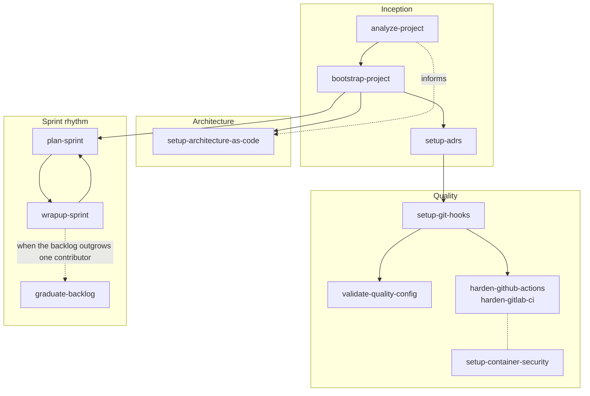
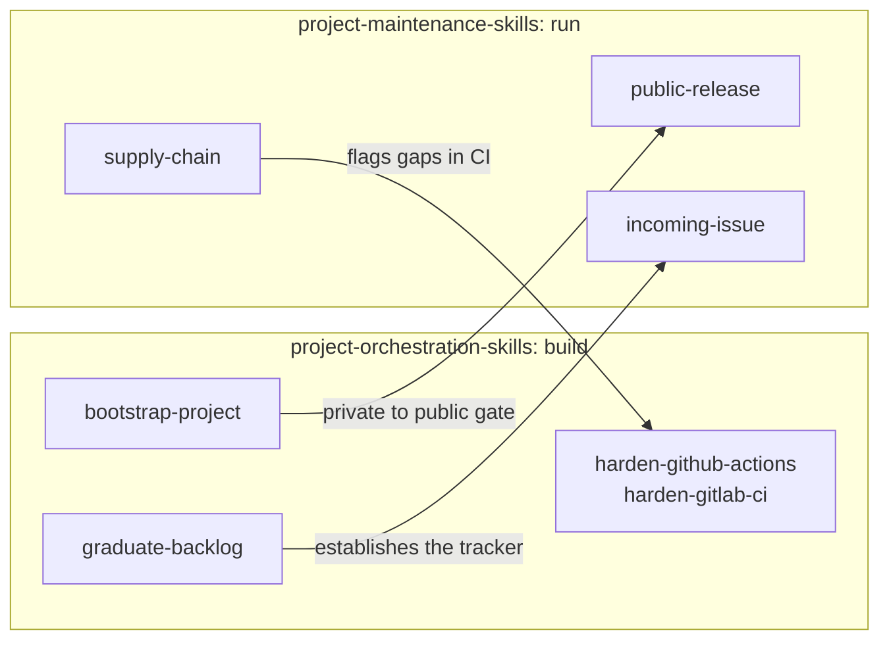

<!-- SPDX-FileCopyrightText: 2026 Georges Martin <jrjsmrtn@gmail.com> -->
<!-- SPDX-License-Identifier: MIT -->

# How the skills fit together

This plugin is a set of skills, and a second plugin, `project-maintenance-skills`, sits beside it. This page explains how they are organised: by what, and why that way. It will help you
decide where to start, and what a skill means when it points at another one.

It is a map of the thinking, not a list of skills. The [README](../../README.md) lists them.

## By moment in a project's life, not by technology

The skills are grouped by *when* in a project's life the work happens: starting it, giving it
structure, putting quality gates around it, and running it in sprints. They are not grouped by
language or tool, because the same moment looks alike across stacks.

Read the arrows as "usually comes before", not as a pipeline you must follow:

- Each skill's "When to Use" and "Related Skills" sections name its neighbours, and the arrows
  above come from them.
- You can enter anywhere. The same sections list uses such as adding quality gates to an
  existing project, or promoting a project from a lower tier to a higher one, so a project that
  is already running does not have to replay its inception.
- Some skills have no fixed predecessor. `setup-container-security` applies when a project builds
  an image, whenever that happens.

## Why decisions sit in the middle

`setup-adrs` writes the project's decision records, and other skills point at them. The git hooks
skill implements practices from the development-practices record, and the sprint skills refer to
the record that documents sprint practices. A skill that changes how the project works has a
place to say so, and a later reader finds the reasoning next to the rule.

`setup-adrs` follows `bootstrap-project` closely, and a skill that raises a decision, such as an
accepted exception to a pinning rule, tells you to record it there.

## Two plugins: building and running

The work that follows a project's first release is a different kind of work from setting it up:
upkeep of dependencies, triage of issues, releases, security incidents, periodic health checks,
supply-chain audits, and the one-time step from private to public. That lives in
`project-maintenance-skills`, and this plugin does not include it.

The two are split by *when the work happens*, as the groups above are. They are not split by
whether the project is open source. The maintenance plugin was once named for open-source work, and
that name turned where the plugin came from into a barrier to installing it. Most of what it does
applies equally to an internal service. One skill in it, `public-release`, applies only when a
project is going public, and says so. Exposure decides which skill applies, not whether you can
install the plugin.

The two plugins hand work to each other at a few named points:

- **Going public.** `bootstrap-project` declares whether a project is private or public.
  `public-release` owns the full checklist for the move from private to public.
- **Supply chain.** The audit in `supply-chain` flags gaps in a project's CI. The skills that
  harden a pipeline close them.
- **Work organisation.** `graduate-backlog` *establishes* a tracker from the in-repo backlog;
  `incoming-issue` *operates* it afterwards.

Neither plugin needs the other. `graduate-backlog`, for instance, creates only the minimal
labels it needs, "so it works standalone in contexts where the maintenance plugin is absent", and
treats the richer setup in `incoming-issue` as "an enrichment, not a prerequisite". A skill that
points across names the other plugin so you can tell where it lives.

## What this means in practice

- **Start from your situation**, not from the top of a list. A new project begins at inception.
  An existing one with no quality gates starts at the quality group.
- **Follow a pointer when it helps**, and ignore it when it doesn't. A "Related Skills" entry is
  a neighbour, not a prerequisite.
- **Use the second plugin when the work is upkeep.** Once the project is running and you are
  triaging issues, cutting releases or answering a vulnerability report, those skills are the
  maintenance plugin's.

## Related

- [Why the skills ship checks, not just instructions](why-checks-fail-instead-of-instruct.md)
  explains the checks that several skills in these groups ship.
- The skills themselves are in [`skills/`](../../skills/).
