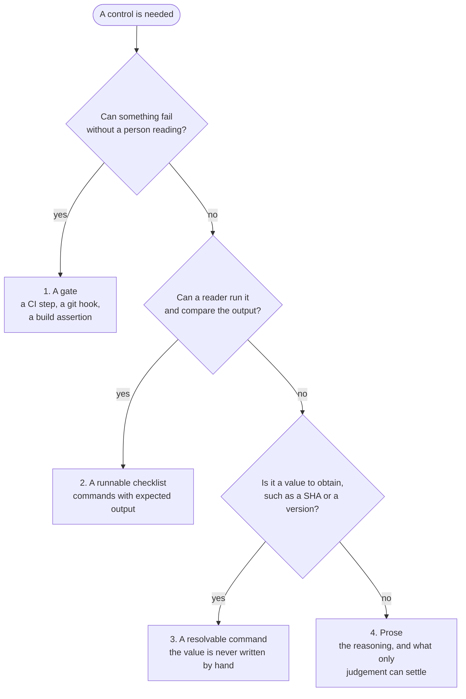

<!-- SPDX-FileCopyrightText: 2026 Georges Martin <jrjsmrtn@gmail.com> -->
<!-- SPDX-License-Identifier: MIT -->

# Why the skills ship checks, not just instructions

Several skills in this plugin could have told you to "make sure" of something. Instead they give
you a script that fails when the thing is wrong. This page explains why, what the choice costs,
and where the skills deliberately stay as prose.

It is background, not a procedure. It does not show you how to run a check.

## A sentence has no failure mode

A skill is a set of instructions an agent follows. The easiest way to add a control is a
sentence: "make sure the actions are pinned to a commit SHA", "verify the package builds
cleanly", "check the history for secrets before going public".

The trouble shows up afterwards. If the sentence was followed, nothing marks it. If it was
skipped, nothing marks that either. The two outcomes look the same, so nobody learns which one
happened.

An agent makes this worse in one specific way. An agent following a skill is exactly the reader
most likely to produce something that *looks* compliant: fluent, plausible, and wrong in a way
that only running it reveals. A check that runs does not care how convincing the output was.

### What the evidence looked like

The maintainer's decision log records a full project build in July 2026 that used these skills
throughout. Three things went wrong where prose was the only guard:

- Action SHAs were required by a skill and were written from memory anyway, twice, during a
  session about supply-chain integrity.
- A recommended `--require-hashes` install was written as instructed and could not work, because
  the skill's example left out the step that generates the lockfile it depends on.
- A roadmap template's milestone labels collided with real version numbers, and nothing noticed
  until a release contradicted the README.

The defects that were caught in the same build were caught by things that *could fail*: a
vulnerability scanner failing the build, a schema-conformance job, a search across every workflow
after a fix to two of them, an assertion about what an SBOM described, and a checklist of
commands that was actually run.

Prose is not useless. It carries the *why*, which an assertion cannot. What it lacks, when it is
the only thing present, is a way to be wrong out loud.

## The order the skills work down

When a skill gains a control, it goes down this list and stops at the first rung that can be
built:

1. **A gate that fails.** The control cannot be skipped without a red build or a blocked commit.
2. **A runnable checklist.** Commands with the output you should see, not bullet points to
   nod at. A person can run it, and so can an agent, and either can report what happened.
3. **A resolvable command.** When a value has to be obtained (a commit SHA, a licence, a
   version), the skill gives the command that obtains it and says the value is never typed from
   memory.
4. **Prose.** For the reasoning, the trade-offs, and anything that only judgement can settle.

The order is a preference, not a quota. Prose is a legitimate place to end up.

## What this looks like when you use a skill

A number of skills ship a script in their own `scripts/` directory, for example
[`check-adrs.sh`](../../skills/setup-adrs/scripts/check-adrs.sh) for the ADR log and
[`check-action-pins.sh`](../../skills/harden-github-actions/scripts/check-action-pins.sh) for
GitHub Actions pins. The skill's Validation section tells you to run the script rather than read
its list of items. You copy the script into your project and run it from the repository root.

The scripts share a few habits that follow from the idea above:

- **They exit non-zero when a check fails**, so a hook or a CI step can stop on them.
- **They fail closed.** A script that could not do its job does not report success. The pin
  checker's header says it plainly: "2, not 0, when it cannot run or finds no `uses:` — a
  checker that checked nothing passed nothing."
- **They say what they do not check.** The bootstrap check's header lists the things it leaves
  to you "because they need a person, a container runtime or a forge".

## A green result proves only what was asserted

A passing check is evidence for the specific thing it tests and for nothing else. That is why
each script names its blind spots. It is also why the checks are themselves treated as
fallible.

The plugin's changelog records the checks being wrong, and being fixed:

- The pin checker once resolved a pin's `# <tag>` comment through an endpoint that answers for
  *any* reference. A comment that simply repeated the pinned SHA, or named a branch, resolved to
  itself and passed. It now resolves the comment as a tag.
- A first version of the hygiene check silently skipped some install commands, because a search
  pattern beginning with `--` was read as an option. The test cases caught it.

Both are the failure mode this page opens with, moved one level up: a check that passes without
having checked. The next page, [How a check is built and proved](how-a-check-is-built-and-proved.md),
explains what the plugin does about it.

## Where the skills stay as prose

Not everything reduces to a check. Scope boundaries, architecture choices and audience analysis
depend on judgement, so the parts of the skills that deal with them are prose. Forcing them into
checklists would produce theatre: boxes ticked with nothing behind them. The prose is worth more
because it is not trying to be a gate.

There is also a risk in the other direction. A skill that becomes a wall of commands is as
unread as one that is a wall of prose.

## What the approach costs

- **Checks are tied to an ecosystem.** "Pin your toolchain" is universal advice. A check for it
  is specific to a language or a forge. This is part of why some skills are built for one forge
  on purpose.
- **Checks need maintaining.** A stale check fails loudly, which beats silence, but it is still
  work. A check that fails when nothing is wrong teaches people to bypass it.
- **Hooks can be bypassed.** A git hook can be skipped with `--no-verify`, and the plugin's own
  hook messages say so. A hook is a prompt to do the right thing, not a guarantee.
- **A check is not the same as a review.** Passing the scripts means the mechanical half is
  sound. The parts that need a person are still yours.

## Related

- The skills themselves are in [`skills/`](../../skills/); each `SKILL.md` links the scripts it
  ships.
- [`CHANGELOG.md`](../../CHANGELOG.md) records the checks being corrected.
