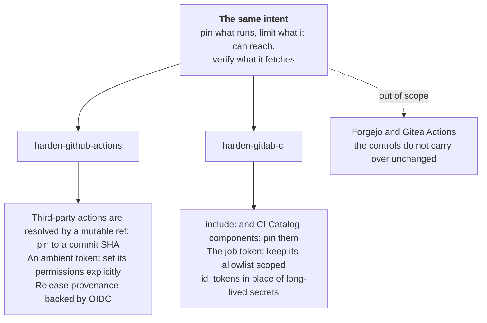

<!-- SPDX-FileCopyrightText: 2026 Georges Martin <jrjsmrtn@gmail.com> -->
<!-- SPDX-License-Identifier: MIT -->

# Why the hardening skills are tied to one forge

Most skills in this plugin avoid depending on a particular forge. Two of them,
`harden-github-actions` and `harden-gitlab-ci`, depend on one on purpose, and each says "by design"
in its opening lines. This page explains why that is an exception and not an oversight, how the
two differ, and what it means that neither covers Forgejo or Gitea.

It is background on the choice. It does not show you how to harden a pipeline.

## The default is to stay out of the forge

The plugin's conventions say a skill that touches a forge should work across `gh`, `glab` and
`tea`, including self-hosted GitLab and Forgejo, and should check command syntax against the
installed tool instead of asserting it. The reasoning is simple: the people using these skills
host their code in different places, and advice that only works on one of them leaves the rest
guessing.

## Why CI hardening is the exception

The conventions then name one family of skills as a sanctioned exception, and give the reason:
CI hardening controls "are properties of a specific CI execution model, not portable concepts
wearing one forge's syntax."

Each hardening skill says the same about itself. The GitHub one calls its controls "properties of
the GitHub Actions execution model itself". The GitLab one says the two forges "differ in what the
risks *are*, not merely in how they are spelled."

So the question is not whether a control can be written in another forge's syntax. It is whether
the same control would *mean* the same thing there. For CI hardening, often it would not.

## What actually differs

Both skills share an intent: pin what runs, limit what it can reach, and verify what it fetches.
They then diverge, because the things to pin, the credentials to limit and the secrets to avoid are
different on each forge.

| | GitHub Actions | GitLab CI |
|---|---|---|
| What runs that you did not write | Third-party actions, resolved by a git ref that can move | `include:` files and CI Catalog components |
| The control for it | Pin each action to a commit SHA, with a comment naming the tag the SHA stands for | Pin includes and components, and pin job images by digest |
| The credential an untrusted step can reach | `GITHUB_TOKEN`, which an action can read through the `github.token` context even when the workflow does not pass it | `CI_JOB_TOKEN`, and project or group variables |
| What the work on it is | Narrowing it: set the workflow's `permissions` explicitly | Keeping it narrow: the allowlist should not grow |
| Secrets and provenance | Release provenance backed by OIDC | `id_tokens`, so long-lived secrets need not exist |

The two bottom rows are the clearest case of "different in kind". On GitHub the skill's work is to
narrow what an ambient token can do. On GitLab, the official documentation says "By default, job
token access is restricted to only CI/CD jobs that run in pipelines in your project" and "By
default, the allowlist of any project only includes itself." There the work is to stop that
narrow default widening, and the skill describes it as "the opposite posture". A skill that
translated one into the other would tell a GitLab user to restrict something that starts
restricted.

Two cautions apply to that table:

- On GitHub, what the token can do by default depends on settings, and the workflow's `permissions`
  key overrides it. That is why the control is to set it explicitly instead of relying on a default.
- On GitLab, the defaults and some edge cases can depend on the version and on settings an
  administrator can enforce. The same documentation notes that a public or internal project can be
  reached for some features without being on the allowlist.

## Why not one skill with a branch per forge

A single "harden your CI" skill that branched on the forge is the obvious alternative. The
conventions choose siblings for two reasons.

The first is the transliteration trap above. When one skill holds both forges, the pull is to
write the second forge's controls as the first one's with the names changed. A sibling is written
from the new forge's risks outward, which is why the conventions say to "build that forge's
*equivalent* controls; do not transliterate another forge's."

The second is how a skill is found. A skill's `description` is its trigger: it is what tells an
agent the skill applies. Two siblings each keep a description that is specific to one forge. One
shared skill would have a description about CI hardening in general, which would match on both
forges, so the agent could load the wrong forge's material.

## What neither skill claims to cover

Each skill states what it is not for, and tells the agent to say so instead of approximating.
Forgejo and Gitea Actions are the example. The GitHub skill notes that Forgejo Actions is
Actions-compatible in shape but "resolves actions against its instance's configured registry, so
pinning guidance does not transfer unchanged."

The conventions describe the family as closed, with one skill per forge. A Forgejo sibling would
be built the same way, from that forge's own risks. Until one exists the answer is an explicit
"not covered", which is more useful than advice that looks right and is not.

Self-hosted GitLab is the other side of that boundary. The GitLab skill treats it as "a
first-class target, not an exception": authenticate once and every control is identical.

## What it costs, and what it is not

- **Some duplication.** The shared intent is written twice, once per sibling, and kept consistent
  by hand and by cross-references.
- **Two sets of checks.** The pin checks are forge-specific too, one for Actions pins and one that
  reads GitLab's YAML. The idea behind them is the one in
  [Why the skills ship checks, not just instructions](why-checks-fail-instead-of-instruct.md).
- **Not a precedent.** The exception covers this family only. The conventions say an exception
  outside it should need a recorded decision, and that other forge coupling is a defect to fix when
  the skill is next touched.

## Related

- [`harden-github-actions`](../../skills/harden-github-actions/SKILL.md) and
  [`harden-gitlab-ci`](../../skills/harden-gitlab-ci/SKILL.md) are the two skills.
- [How the skills fit together](how-the-skills-fit-together.md) shows where they sit among the
  quality skills.
