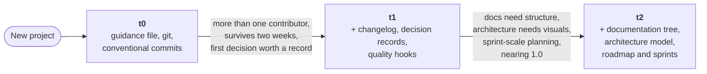
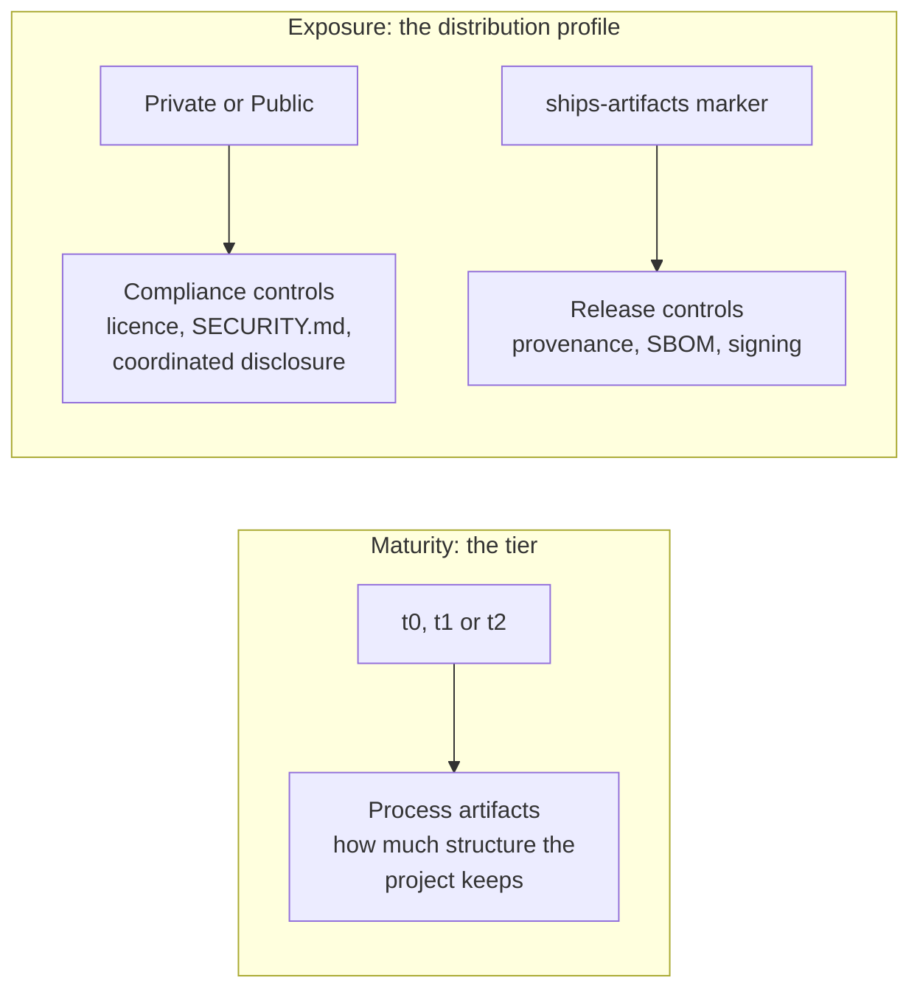

<!-- SPDX-FileCopyrightText: 2026 Georges Martin <jrjsmrtn@gmail.com> -->
<!-- SPDX-License-Identifier: MIT -->

# Why a project grows through tiers

`bootstrap-project` does not set every project up the same way. It sets a project up at one of
three tiers, t0, t1 or t2, and expects the project to move up when it needs to. A second setting,
the distribution profile, is kept separate on purpose. This page explains the reasoning behind both.

It is background on the idea. The skill's own [Tier Selection](../../skills/bootstrap-project/SKILL.md#tier-selection)
and [Phases by Tier](../../skills/bootstrap-project/SKILL.md#phases-by-tier) sections are the
authority on exactly what each tier contains, so this page does not repeat them in full.

## Two ways to get process wrong

Starting a project with all the process it will ever need is one way to get it wrong. A weekend
prototype buried under decision records, a roadmap and a documentation tree either gets
abandoned or gets filled with text nobody believes.

Starting with none is the other. Decisions get made in a chat window, and the chat is gone when
the session ends. With an AI assistant doing much of the work this is the usual case, and what
is lost is the *reasoning*: not what the code does, but why it was built that way.

Tiers answer both. A project starts small, grows when something tells it to, and keeps one
property true the whole way.

## The property that does not change

The skill states it directly: "at every tier, decision rationale is captured at decision-time in
durable, version-controlled artifacts (CLAUDE.md, conventional commits, ADRs). No tier requires
recovering rationale from non-durable sources (chat logs, agent session memory)."

That is why even the lowest tier is not empty. It has a project-guidance file and a commit
history written to a convention, the smallest set that keeps the reasoning somewhere that
outlasts the session. Everything above that is more structure around the same habit.

## Each tier contains the one below

Each tier is a superset of the previous one, and the skill describes promotion as "mechanical
(reformat / reorganize), not archaeological". Going up means adding structure to something that
is already recorded. It never means reconstructing what happened from memory.

In outline, and with the skill as the authority:

- **t0** is the foundation: the guidance file, git, and commit messages written to a convention.
- **t1** adds a changelog, the first decision records and quality hooks.
- **t2** adds a documentation tree, an architecture model, a roadmap and a sprint cadence.

The skill's advice is to pick the lowest tier that fits the project's current state. A project
that already exists, with its history in a chat window, starts at t0 straight away and is
promoted from there, rather than being forced into a structure it cannot fill honestly.

## When a project moves up

The triggers are the skill's. One way to read them is that each marks a point where something
stops living in one person's head. A second contributor, two weeks of elapsed time, and a first
decision that deserves a number are all moments when a reader arrives who was not there. At the
next step, documentation, architecture and planning have outgrown a single guidance file.

These are guidance, not tests. Nothing measures the number of contributors and promotes the
project for you.

## A second setting: exposure

The tier measures how mature a project's *process* is. How far the software *travels* is a
different question, and the skill keeps it as a separate setting, the distribution profile:
Private by default, or Public. In the skill's words, "A mature internal tool has no external
obligations; an early public library incurs them the moment it ships."

The two settings are independent, and the skill says what follows: "Controls attach to the
profile, not the tier, so a project pays only for its actual exposure." Its own example is
that a t0 project that is Public still needs a security policy, and a t2 project that is Private
does not.

The `ships-artifacts` marker works the same way. It is "a boolean, not a rung": set it when the
project publishes built packages or images, whether at the moment of going public, later, or
never. It does not mark a step above Public.

The skill ties the profiles to published guidance, such as the EU Cyber Resilience Act's
duties for open-source stewards and the SLSA framework for release provenance, and is plain about
the limit: "Treat these as guidance, not legal advice."

## How the checks use it

A project declares its tier in its guidance file, and the skill's check script reads it from
there. The check is cumulative, so a t2 project is checked against t0 and t1 as well. If you pass
a tier that disagrees with what the file declares, that disagreement is itself a failure. The
profile gates the checks in the same way: a Public project is also checked for the security
policy, whatever its tier.

This is the idea from [Why the skills ship checks, not just instructions](why-checks-fail-instead-of-instruct.md)
applied to the tiers. The declared tier is a claim, and the script is what tests it.

## What it costs

- **Two settings to keep straight.** A project has a tier and a profile, and they answer
  different questions. Treating them as one scale is the easy mistake.
- **A default that pulls the other way.** If you give `bootstrap-project` nothing more, it
  defaults to t2. Its selection advice is to pick the lowest tier that fits. For a small project
  those point in opposite directions, and the selection table is the part that states the intent.
- **The check tests what is declared.** It confirms that a project has the artifacts for the tier
  it claims. It cannot tell you whether the project should be at a different tier.

## Related

- [`bootstrap-project`](../../skills/bootstrap-project/SKILL.md) is the skill, with the full tier
  and profile tables.
- [How the skills fit together](how-the-skills-fit-together.md) shows where inception sits
  among the other skills.
- The move from Private to Public is handled by `public-release`, in the sibling plugin
  `project-maintenance-skills`.
